<p align="center">
  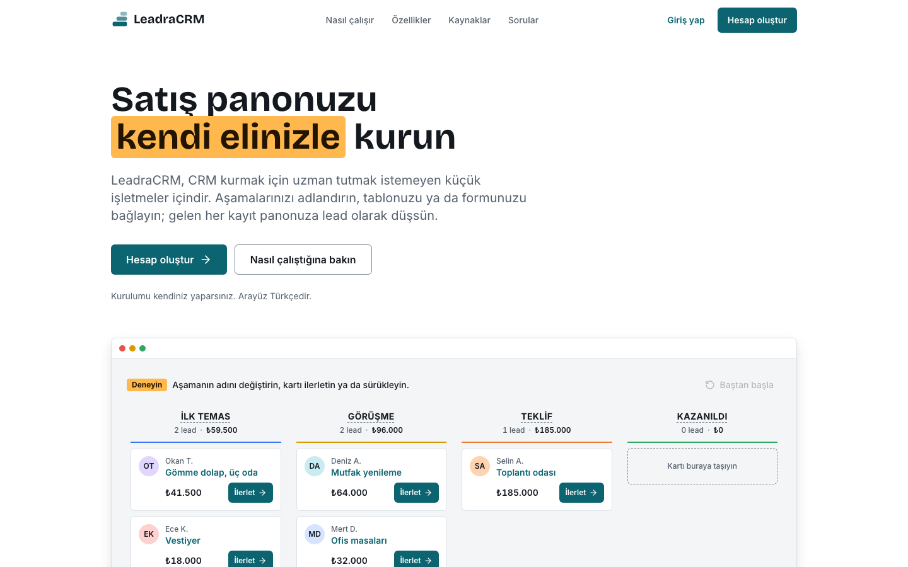
</p>

# LeadraCRM

**Kendi başınıza kurduğunuz satış CRM'i.** Aşamalarınızı adlandırırsınız, tablonuzu ya da formunuzu bağlarsınız; gelen her kayıt panonuza lead olarak düşer. Kurulum için uzman gerekmez, arayüzün tamamı Türkçedir.

LeadraCRM küçük satış ekipleri içindir: gelen talepleri tek panoda toplar, kimin neyle ilgilendiğini gösterir, yapılacakları hatırlatır ve hangi işin nerede takıldığını raporlar.

> **Durum: erken sürüm.** Uygulama kendi bilgisayarınızda uçtan uca çalışır ve 304 uçtan uca testle denetlenir. Kayıt ve giriş, kullanıcı daveti, abonelik ve koltuk, Telegram kanalı kuruludur; ancak e-posta gönderimi, ödeme ve Telegram yalnız yerel taklitlere karşı denenmiştir, gerçek hizmetlerle doğrulanmamıştır. Diğer mesajlaşma kanalları henüz yoktur. Ayrıntı için [Durum](#durum) bölümüne bakın.

## İçindekiler

- [Ekran ekran LeadraCRM](#ekran-ekran-leadracrm)
- [Durum](#durum)
- [Kurulum](#kurulum)
- [Komutlar](#komutlar)
- [Nasıl kuruldu](#nasıl-kuruldu)
- [Klasör yapısı](#klasör-yapısı)
- [Tasarım sistemi](#tasarım-sistemi)
- [Testler](#testler)
- [Güvenlik](#güvenlik)
- [Ortam değişkenleri](#ortam-değişkenleri)
- [Yol haritası](#yol-haritası)
- [Marka ve lisans](#marka-ve-lisans)

## Ekran ekran LeadraCRM

Aşağıdaki görüntülerin tamamı uygulamanın kendisinden, depodaki örnek veriyle çekildi. Kişi ve şirket adları uydurmadır.

### Bugün

Uygulama sizi günün özetiyle karşılar: yoldaki satışın tutarı, son yedi günün yeni ve kazanılan lead'leri, satış hattınız (üstündeki renk şeridi her aşamanın tutardaki payını gösterir), bugünün ve geciken görevleriniz, yanıt bekleyen konuşmalar.

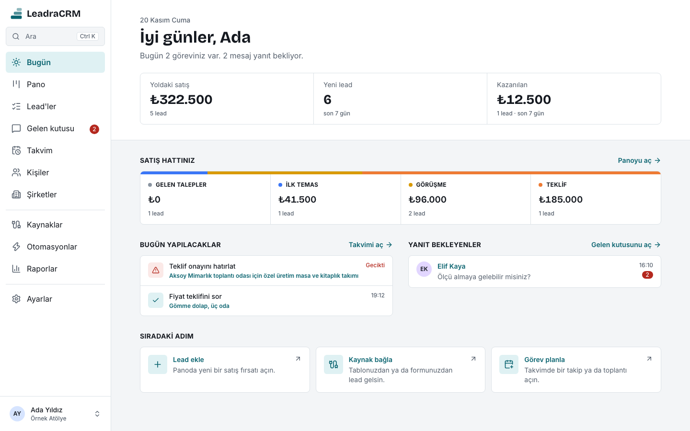

### Pano

Satış hattınız sütunlar hâlinde durur. Her aşamanın başlığında lead sayısı ve toplam tutar yazar; altındaki ince çizgi aşamanın rengindedir. Kartta kişi, şirket, son mesaj, etiketler, tutar ve sorumlu bir bakışta görünür.

- Kartı sürükleyerek ya da kart menüsünden (klavyeyle de) başka aşamaya taşırsınız.
- İlk aşamanın başındaki "Hızlı ekle" ile panodan ayrılmadan lead açarsınız.
- Birden çok satış hattı açabilir, listedeki sıralarını değiştirebilirsiniz; aşamaları ekler, adlandırır, renklendirir, sıralar ve silersiniz.
- "Gelen talepler" sütunu yeni talepleri bekletir: kabul eder, reddeder ya da var olan bir lead'e bağlarsınız.
- Hazır süzgeçler (Benim, Görevsiz, Okunmamış), özel süzgeç (sorumlu, aşama, tarih, etiket) ve kayıtlı süzgeçler vardır.
- Görevi olmayan lead kartında uyarı çıkar.

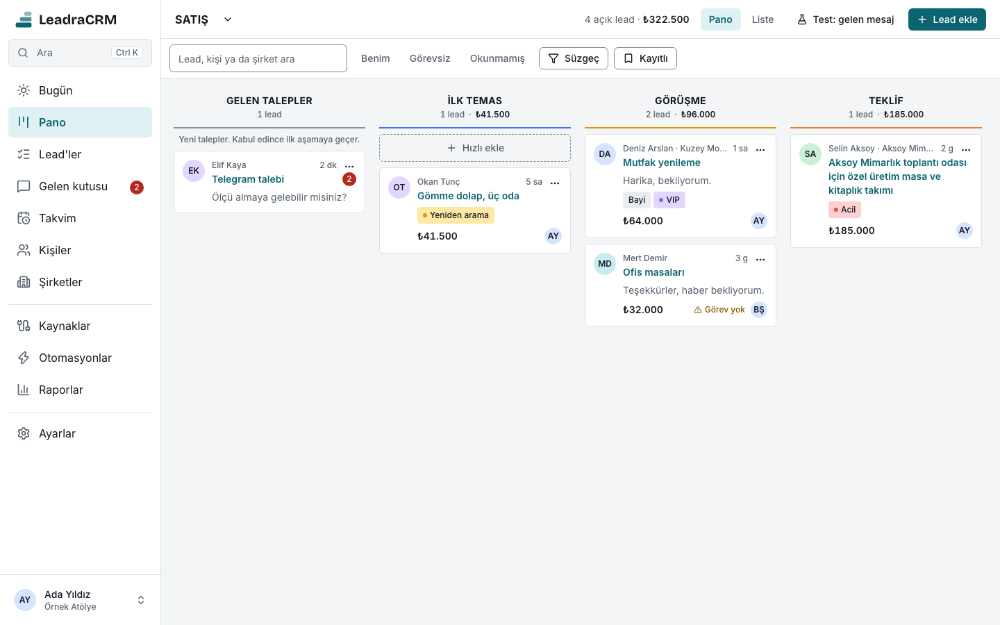

Bir lead "Kazanıldı"ya taşındığında pano bunu kutlar: renkli parçalar düşer, üstte lead'in adı ve tutarı belirir. Hareketi azaltmayı seçen kullanıcılarda yalnız şerit görünür.

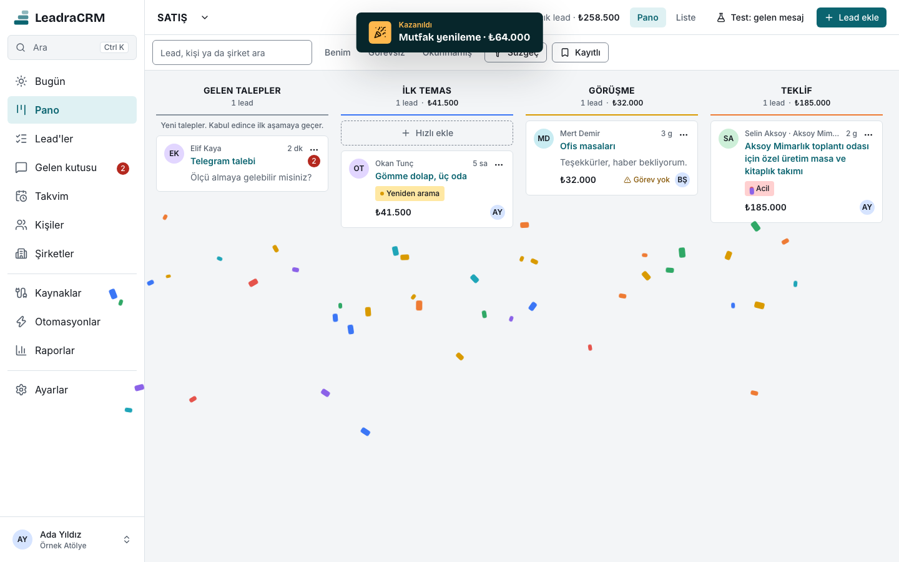

### Lead kartı

Solda lead'in bilgileri, sağda o lead'le ilgili her şeyin akışı durur.

- Ad, tutar, aşama ve sorumlu yerinde düzenlenir.
- Kişi ve şirket bağlanır ya da ayrılır; renkli etiketler eklenir.
- Kendi tanımladığınız özel alanlar (metin, sayı, seçim, çoklu seçim, tarih, onay kutusu, bağlantı) burada görünür.
- Akışta mesajlar, notlar, görevler ve aşama değişiklikleri tarih sırasıyla yer alır.
- Silinen lead geri alınabilir; kaybedilen lead için kayıp nedeni seçilir.

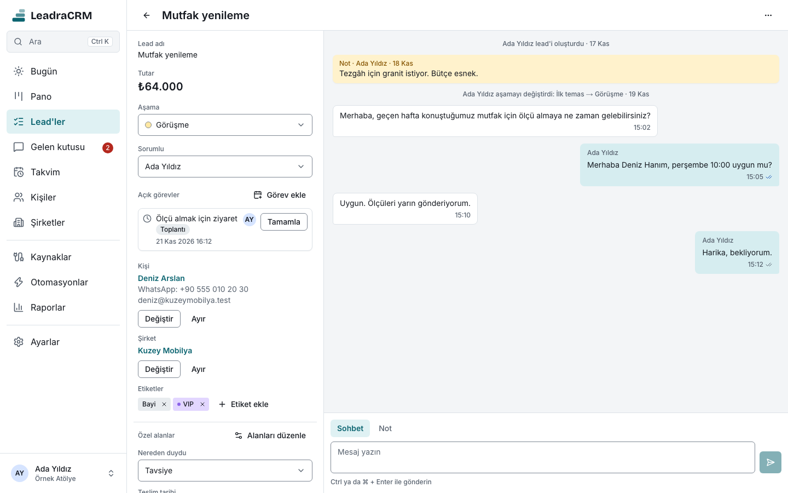

### Lead listesi

Aynı lead'lerin tablo görünümü. Sıralar, süzer, birden çok lead seçip toplu olarak sorumlu, aşama ya da etiket değiştirir, silersiniz. Listeyi dosyaya aktarabilir, elinizdeki müşteri listesini sütunları eşleyerek dosyadan içe alabilirsiniz.

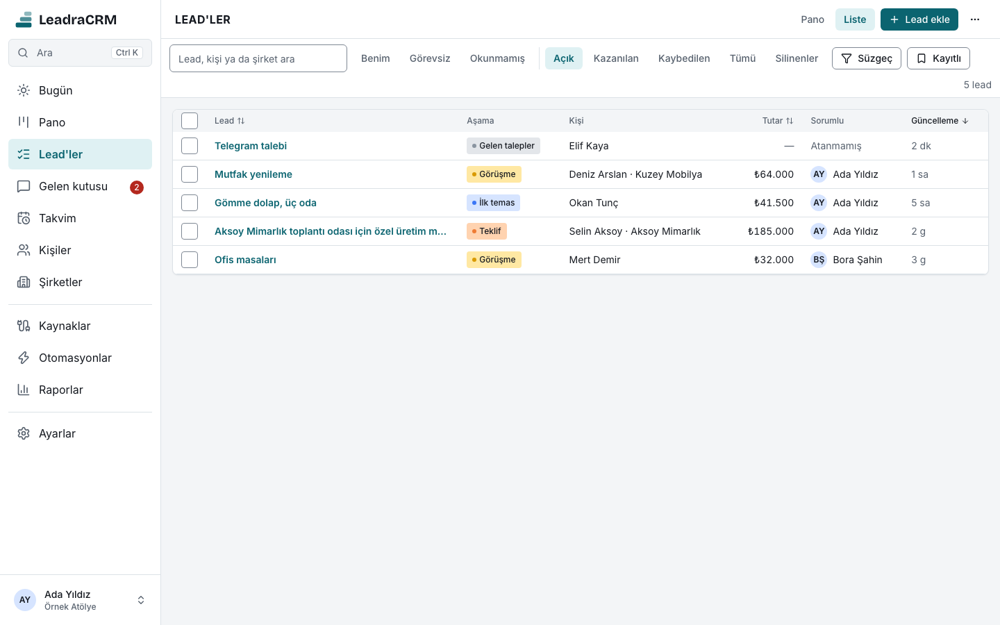

### Gelen kutusu

Bütün konuşmalar tek listede. Konuşmayı bir ekip üyesine atar, kapatır, ilgili lead'i açarsınız. Aynı konuşmaya lead kartından da yazılır.

> Görüntüdeki konuşmalar örnek veridir. Gerçek kanal bağlantısı henüz yapılmadığı için mesaj gönderme ve teslim durumları şimdilik taklittir.

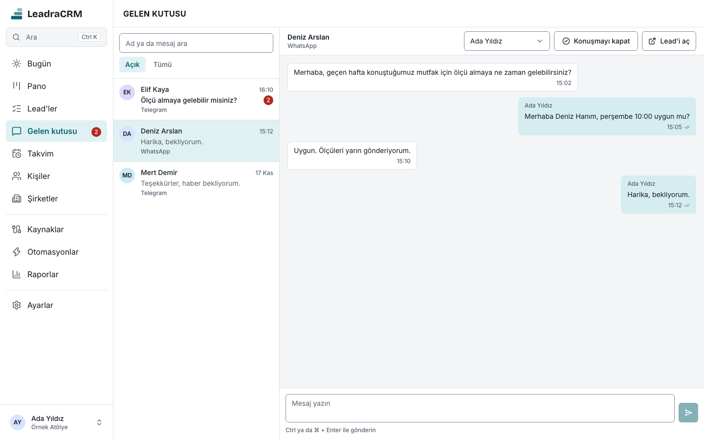

### Takvim ve görevler

Görevler gün, hafta ve ay görünümünde. Her görevin son tarihi, sorumlusu ve türü vardır; Takip ve Toplantı hazır gelir, yönetici kendi türlerini ekler. Görev sonuç yazılarak tamamlanır. Gecikenler ayrı bölümde durur.

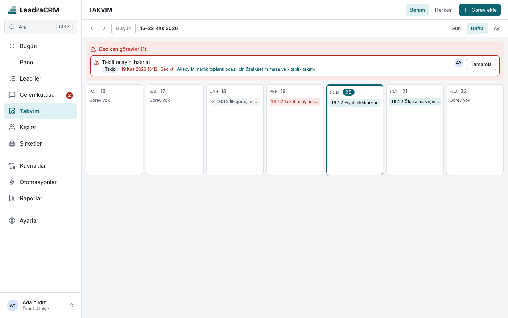

### Kaynaklar

Lead'in nereden geleceğini buradan bağlarsınız. Bugün bağlanabilenler: **Google Sheets, Google Forms, Telegram (kendi botunuzun belirteciyle), Zapier, Make, n8n, kendi sisteminiz (gizli bir adrese veri gönderen her şey) ve dosyadan içe aktarma.** Her kaynak için lead'in düşeceği aşamayı ve eklenecek etiketi seçersiniz.

Telegram'da bota yazan kişi gelen taleplere düşer, yanıt gelen kutusundan gider; gönderilemeyen mesajda neden yazar ve yeniden denenir. Diğer mesajlaşma kanalları (WhatsApp, Instagram, Messenger, TikTok, Viber, e-posta, SMS, site sohbeti) aynı ekranda "Sırada" başlığı altında listelenir; henüz bağlanamaz. (Aşağıdaki görüntü Telegram eklenmeden önce çekildi.)

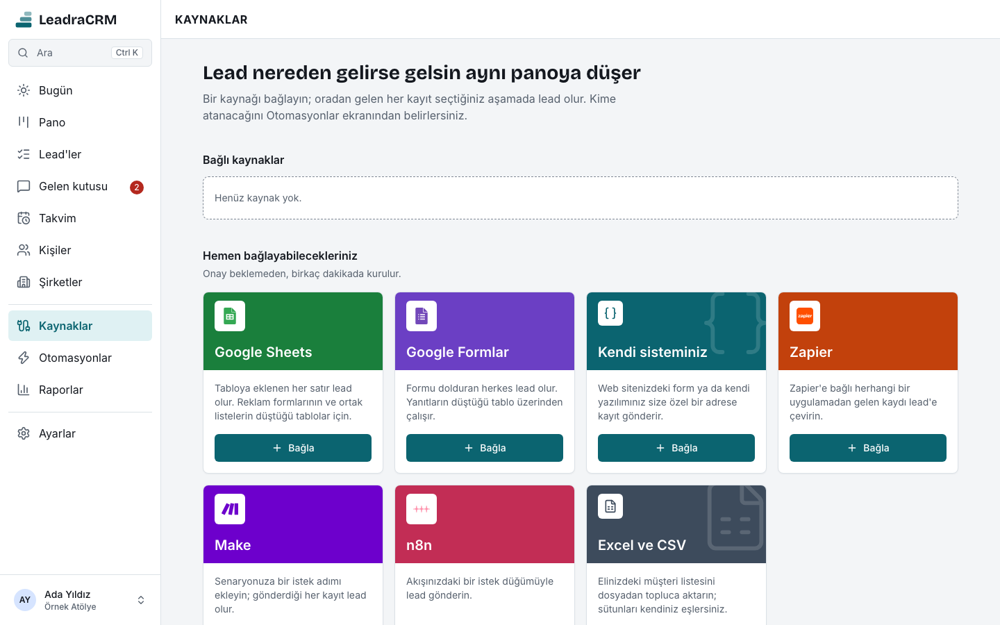

#### Google hesabıyla tablo bağlama

Google hesabınızla oturum açarsınız, tabloyu ve sayfayı seçersiniz, sütunlar kendiliğinden okunur. Bağlandıktan sonra tabloya eklenen her satır, Google'ın gönderdiği bildirimle elle eşitlemeye gerek kalmadan lead olur. Bildirim gelmezse zamanlanmış iş ve "Şimdi eşitle" düğmesi aynı işi yapar.

Uygulama yalnız sizin seçtiğiniz dosyaya erişim ister (`drive.file` izni); Google yenileme anahtarı veritabanında şifreli saklanır.

> Bu akış şimdilik yalnız depodaki yerel Google taklidiyle denendi; görüntüdeki sarı uyarı bunu söyler. Gerçek Google anahtarlarıyla doğrulanması gerekir.

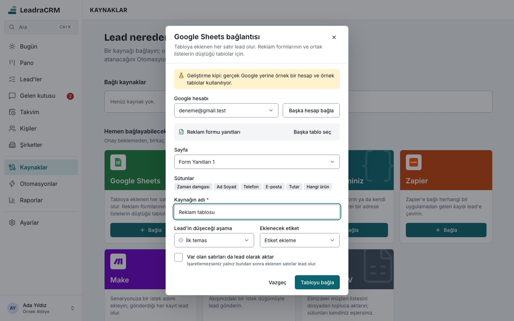

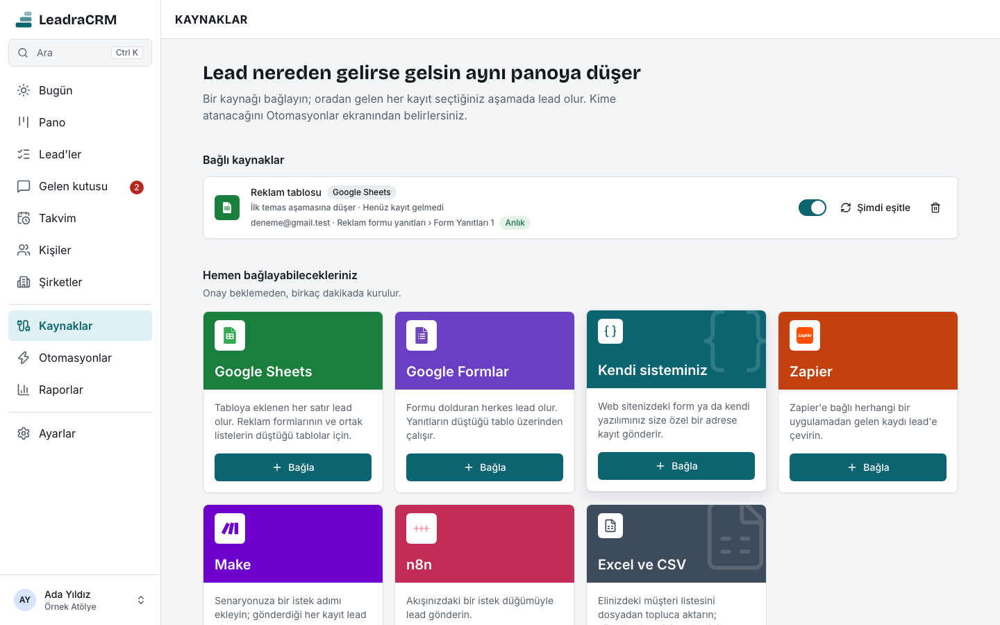

### Otomasyonlar

Her aşamaya tetikleyici eklenir: lead o aşamada oluşturulduğunda ya da o aşamaya taşındığında görev eklenir, sorumlu belirlenir (belirli bir kişi ya da ekip içinde sırayla dağıtım), etiketler düzenlenir ya da lead başka aşamaya taşınır.

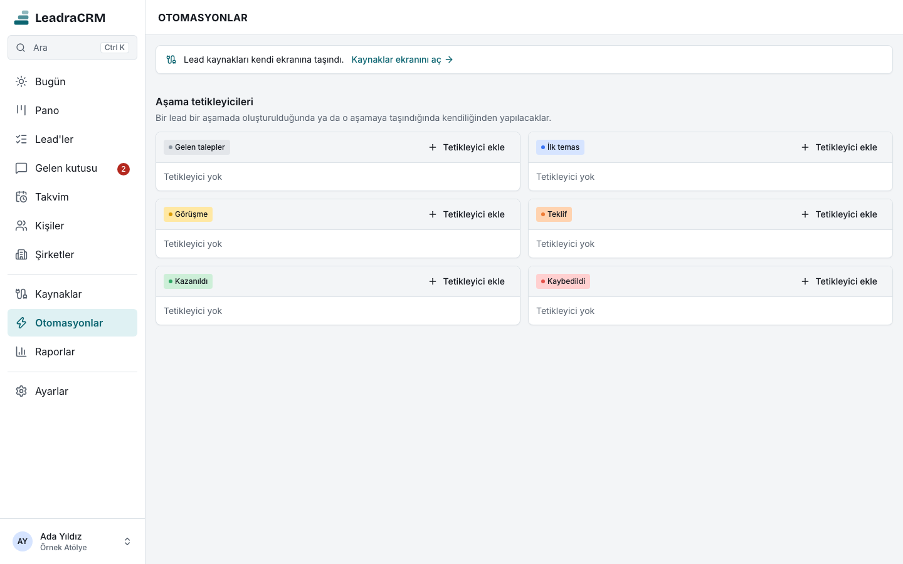

### Raporlar

Seçtiğiniz dönem (7, 30 ya da 65 gün) ve kişi için: yeni, kazanılan, kaybedilen ve açık lead'ler; günlük yeni lead grafiği (tablo olarak da okunur), kazanma oranı, aşamalara göre dağılım, kayıp nedenleri, kişilere göre sonuçlar ve son etkinlikler.

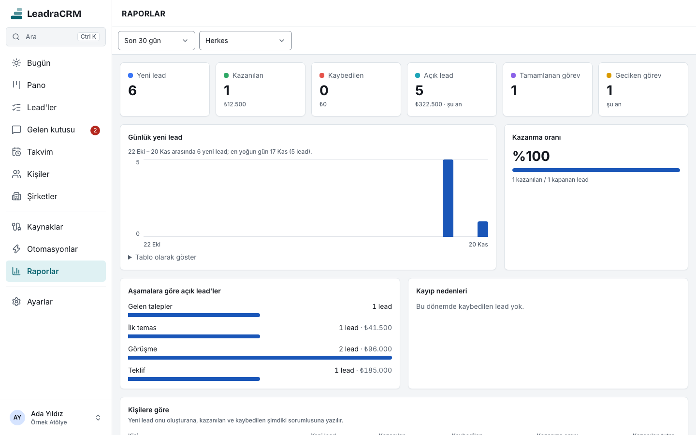

### Kişiler ve şirketler

Kişi ve şirket listeleri sıralanır, süzülür, aranır. Her kişinin ve şirketin kendi kartı, bağlı lead'leri ve özel alanları vardır. `Ctrl K` ile açılan genel arama lead, kişi ve şirketlerde birlikte arar.

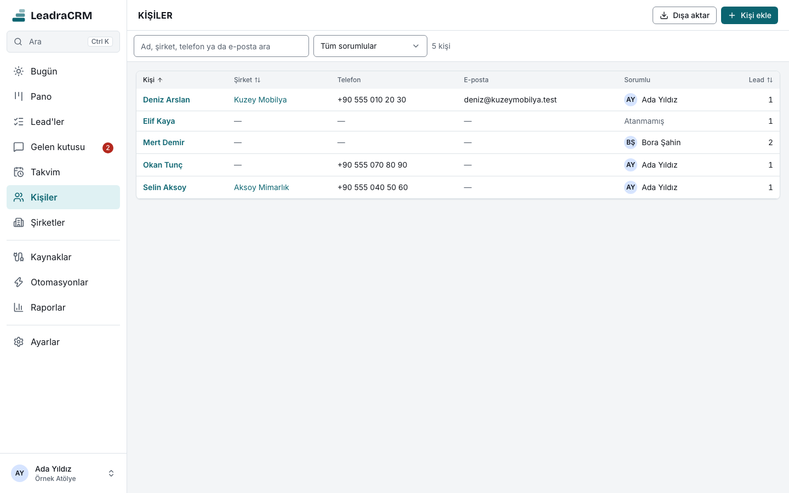

### Ekip ve yetkiler

Yönetici her üyenin rolünü ve grubunu belirler, üyeyi pasifleştirebilir. Çalışma alanı ayarlarında para birimi, saat dilimi, saat biçimi (12 ya da 24 saat) ve tarih biçimi seçilir. Yetkiler bir matristen verilir: her bölüm ve eylem için dört düzeyden biri seçilir (örneğin "yalnız kendi lead'lerini görsün"). Bu kurallar yalnız arayüzde değil, veritabanında da uygulanır. Yeni kullanıcı daveti, gerçek giriş sistemi bağlandığında açılacaktır.

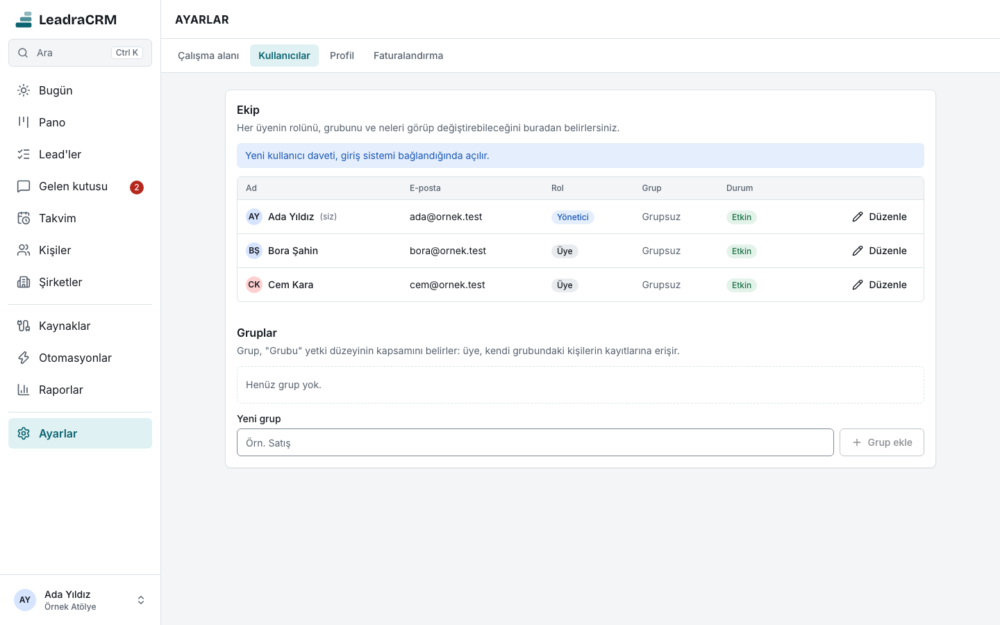

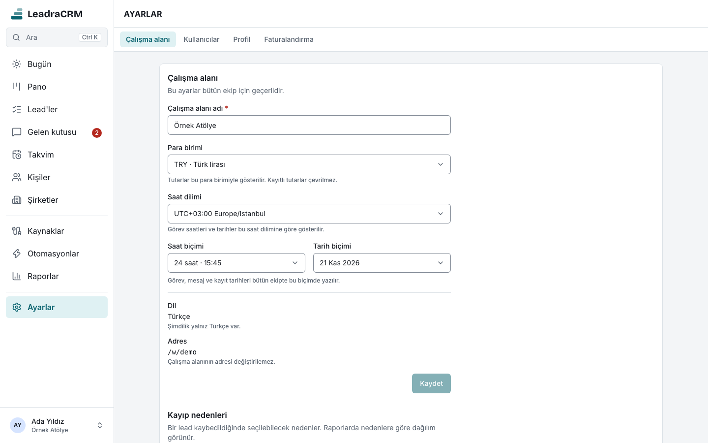

### Hesap oluşturma

Kayıt formu çalışma alanını Türkçe aşamalar, yönetici üyeliği ve hazır kayıp nedenleriyle kurar.

> Şimdilik yalnız geliştirme ortamında çalışır: şifre saklanmaz ve doğrulanmaz. Üretimde bu uçlar bilerek kapalıdır (bkz. [Güvenlik](#güvenlik)).

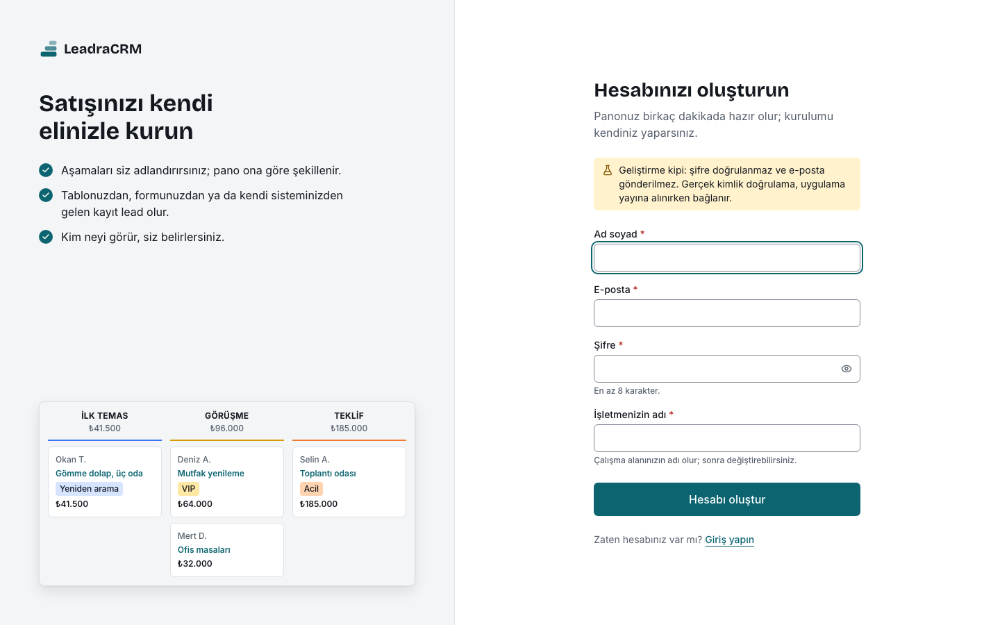

### Telefonda

Ekranlar 390 piksel genişlikte de kullanılır; sol menü simge şeridine iner.

<p align="center">
  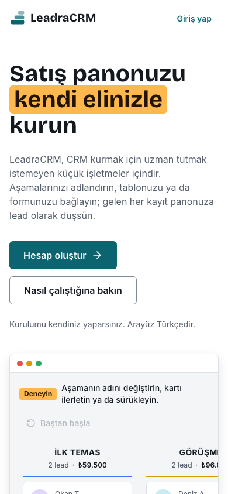
  &nbsp;
  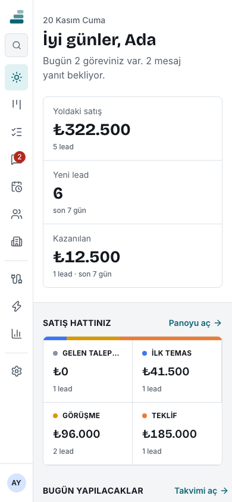
  &nbsp;
  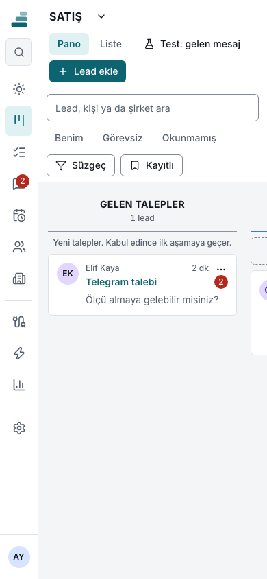
</p>

### Tanıtım sayfası

Ziyaretçi ürünü anlatan yazıyı okumadan önce dener: sayfanın başındaki panoda aşama adlarını değiştirir, kartları ilerletir ya da sürükler. Bu pano yalnız tarayıcıda çalışır, hiçbir yere veri göndermez. Sayfada uydurma kullanıcı yorumu, kullanıcı sayısı ya da puan yoktur.

<details>
<summary>Tanıtım sayfasının tamamını göster</summary>

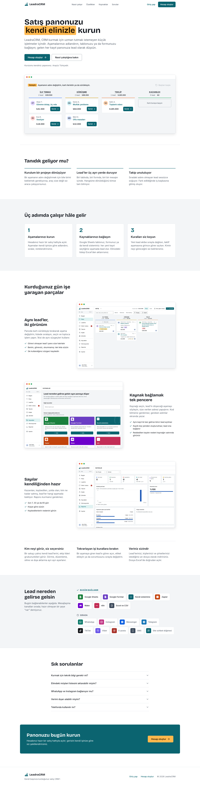

</details>

## Durum

| Alan | Durum |
| --- | --- |
| Pano, lead kartı, lead listesi, süzgeçler, toplu işlemler | Çalışıyor |
| Kişiler, şirketler, özel alanlar, etiketler | Çalışıyor |
| Görevler ve takvim | Çalışıyor |
| Aşama tetikleyicileri, sırayla dağıtım | Çalışıyor (alan değiştiren tetikleyici yok) |
| Raporlar | Çalışıyor (kaynağa göre kırılım yok) |
| Ekip, gruplar, yetki matrisi | Çalışıyor |
| Dosyadan içe ve dosyaya dışa aktarma | Çalışıyor |
| Dışarıdan lead alma (gizli adres), Zapier, Make, n8n, Google Forms | Çalışıyor |
| Google hesabıyla tablo bağlama | Yalnız yerel Google taklidiyle denendi; gerçek anahtarlarla doğrulanmadı |
| Telegram kanalı | Çalışıyor; yalnız yerel Telegram taklidiyle denendi |
| Gelen kutusu | Telegram'da gerçek gönderim; örnek verideki diğer kanallar taklit |
| Kayıt, giriş, e-posta doğrulama, şifre sıfırlama | Çalışıyor (uygulamanın kendi şifreli girişi); e-posta yalnız yerel giden kutusuyla denendi. Üretimde `APP_SECRET` ve bir e-posta anahtarı gerekir |
| Kullanıcı daveti | Çalışıyor; koltuk denetimiyle |
| Abonelik ve koltuk | Deneme, koltuk, aylık ya da yıllık dönem, tek tıkla iptal çalışıyor; gerçek ödeme sağlayıcısı bağlı değil (yalnız geliştirme taklidi), fiyat geçici |
| WhatsApp, Instagram, Messenger, Viber, SMS, e-posta kutusu, site sohbeti | Yok |
| Web formu, sohbet botu, şablonlar | Yok |
| Yasal sayfalar (gizlilik, koşullar) | Yok |
| Canlı ortam (barındırma, alan adı) | Yok |
| Dil | Yalnız Türkçe |

## Kurulum

Gerekenler: **Node 22** ve **Postgres 16** (`initdb`, `pg_ctl`, `psql` yolda olmalı; macOS'ta `brew install postgresql@16`).

```bash
git clone https://github.com/OzdmrYsn/leadracrm.git
cd leadracrm
npm install
cp .env.example .env.local
npm run dev
```

`npm run dev` ilk çalıştırmada proje klasöründe yerel bir Postgres kümesi kurar (`.pgdata/`, 54329 numaralı kapı), göçleri ve örnek veriyi yükler.

- Tanıtım sayfası: <http://localhost:3000>
- Uygulama: <http://localhost:3000/w/demo/home>

Geliştirmede oturum, örnek çalışma alanının yöneticisi olarak hazır gelir; giriş yapmanız gerekmez.

## Komutlar

```bash
npm run dev          # geliştirme sunucusu (yerel veritabanını da başlatır)
npm run build        # üretim derlemesi
npm run db:reset     # yerel veritabanını silip göçleri ve örnek veriyi baştan yükler
npm run db:test      # şema ve erişim kuralı denetimleri (geçici bir Postgres kümesinde)
npm run typecheck    # tip denetimi
npm run lint         # lint
npm run e2e          # uçtan uca testler (Playwright)
npm run tokens       # tasarım token'ları → src/styles/tokens.css
npm run brand-icons  # kaynak karolarındaki marka işaretlerini yeniden üretir
```

## Nasıl kuruldu

| Katman | Seçim |
| --- | --- |
| Uygulama | Next.js 16 (App Router), React 19, TypeScript |
| Arayüz | Tailwind CSS 4 (yalnız kendi token'larıyla), Radix UI, Lucide simgeleri |
| Veri | Postgres; satır düzeyi güvenlik (RLS); `postgres` sürücüsü |
| İstemci verisi | TanStack Query |
| Sürükle bırak | dnd-kit |
| Doğrulama | zod (her uçta, sunucuda) |
| Test | Playwright ve axe |

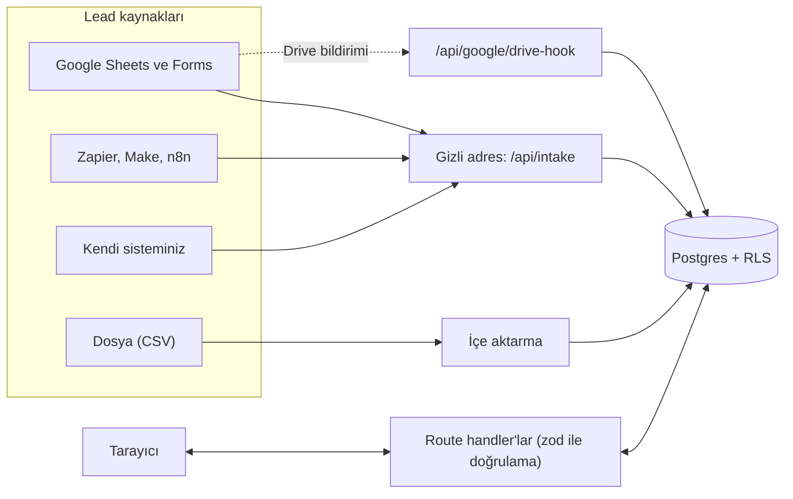

- **Çalışma alanı yalıtımı veritabanındadır.** Her istek kullanıcının kimliğiyle bir işlem açar; hangi satırın görüleceğine Postgres'in satır düzeyi güvenlik kuralları karar verir. Bir sorguda süzgeç unutulsa bile başka çalışma alanının verisi dönmez. Şemada 52 tablo ve 53 kural vardır; tabloların bir kısmı sıradaki özellikler için şimdiden hazırdır.
- **Arayüz metinleri tek dosyadadır** (`src/i18n/tr.ts`). Ürünün adı da yalnız orada yazar.
- **Her dış kaynak aynı kapıdan girer.** Tablo, form ya da otomasyon aracı fark etmez: kayıt doğrulanır, tekrar gelen kayıt ayıklanır, lead seçilen aşamaya düşer ve o aşamanın tetikleyicileri çalışır.

## Klasör yapısı

```
src/
  app/                 sayfalar ve API uçları (96 route handler)
    w/[ws]/            çalışma alanı ekranları: home, pipelines, leads, inbox, calendar, sources ...
    api/               w/ (uygulama), intake/ (dış kaynaklar), hooks/ (kanal ve ödeme bildirimleri), google/, auth/, jobs/, dev/
  features/            ekranlar: board, lead, inbox, sources, home, landing, insights ...
  components/          app/ (kabuk), ui/ (temel bileşenler), brand/ (logo)
  server/              pg/ (sorgular), channels/ (kanal adaptörleri), billing/ (abonelik), google/, auth, password, mail, rate-limit, secret-box
  i18n/tr.ts           bütün arayüz metinleri
  styles/tokens.css    üretilen dosya; elle düzenlenmez
supabase/
  migrations/          veritabanı şeması ve erişim kuralları
  seed.sql             örnek veri
e2e/                   uçtan uca testler
replica/
  design/tokens.json   tasarım token'larının kaynağı
  schema-test/         şema ve erişim kuralı denetimleri
docs/screenshots/      bu sayfadaki görüntüler
```

Kod yorumlarında adı geçen diğer `replica/*.md` dosyaları iç planlama notlarıdır ve bu depoda yer almaz.

## Tasarım sistemi

Görsel dil üç kurala dayanır: açık zemin, ince çizgi, yoğun bilgi. Menü ve kartlar beyazdır; derinlik gölgeyle değil bir piksellik çizgilerle kurulur. Renk az ve anlamlıdır: petrol yeşili tıklanabilen şeyi, sarı dikkat isteyeni, aşama renkleri satış hattındaki yeri gösterir.

- Bütün renk, yazı, aralık, köşe ve gölge değerleri `replica/design/tokens.json` dosyasındadır. `npm run tokens` bunları `src/styles/tokens.css` dosyasına çevirir.
- Tailwind'in hazır renk paleti kapalıdır; bileşenlerde ham renk kodu yoktur.
- Kullanıcının seçtiği renkler (aşama, etiket) renk kodu değil, 1 ile 8 arası bir palet anahtarıdır.
- Arayüzde kullanılan 52 metin ve zemin çifti WCAG AA kontrast eşiğini geçer.
- Hareket, hareketi azaltmayı seçen kullanıcılarda kapanır; hiçbir içerik bir canlandırmanın bitmesine bağlı değildir.
- Yazı tipleri: Inter ve başlıklarda Bricolage Grotesque (ikisi de SIL Open Font License).
- Temel bileşenler geliştirme ortamında `/design` adresinde tek sayfada görülür.

## Testler

30 dosyada 304 uçtan uca test vardır. Her test örnek veriyi sıfırlar ve şunlardan birini görürse başarısız olur: tarayıcı konsolunda hata, sunucudan 5xx yanıtı, beklenmeyen 4xx yanıtı. Ekranlar axe ile WCAG 2.2 AA'ya göre taranır; ikinci bir kullanıcının verisinin görünmediği ayrıca denetlenir.

```bash
npx playwright install chromium   # yalnız ilk seferde
npm run e2e
npm run db:test
```

## Güvenlik

- Gizli anahtarlar yalnız ortam değişkenlerinde durur; `.env.local` depoya girmez.
- Her uç, girdiyi sunucuda zod ile doğrular ve yetkiyi veritabanında denetler.
- Kayıt, giriş ve dış kaynak uçlarında hız sınırı vardır.
- Dış kaynak adresleri gizli bir anahtar taşır; anahtar yenilenebilir.
- Google yenileme anahtarı veritabanında AES-256-GCM ile şifreli saklanır (`APP_SECRET`).
- Şifreler scrypt özetiyle saklanır; oturum çerezi http-only'dir ve veritabanında yalnız özeti durur. Kanal anahtarları şifreli saklanır ve hiçbir yanıtta dönmez.
- Abonelik durumu yalnız ödeme sağlayıcısının imzalı bildirimiyle değişir. Abonelik etkin değilken veritabanı işlemleri salt okunur açılır: veri okunur ve dışa aktarılır, yazılamaz.
- **Geliştirme kolaylıkları üretimde çalışmaz:** `/api/dev/*` uçları, taklit hizmetler, `/dev/*` ve `/design` sayfaları 404 döner; oturum açmadan örnek yönetici sayılma yolu kapalıdır. Üretimde uygulama sırrı ve e-posta anahtarı tanımlı değilse kayıt ve giriş 503 döner.

Bir güvenlik açığı bulursanız lütfen herkese açık bir kayıt açmak yerine depo sahibine özelden yazın.

## Ortam değişkenleri

Bütün adlar ve açıklamaları [`.env.example`](.env.example) dosyasındadır. Yerel geliştirme için yalnız `DATABASE_URL` gerekir ve hazır gelir.

| Değişken | Ne için |
| --- | --- |
| `DATABASE_URL` | Postgres bağlantısı |
| `APP_SECRET` | Dış hizmet anahtarlarını şifrelemek için; üretimde zorunlu |
| `APP_URL` | Uygulamanın dışarıdan görünen adresi |
| `CRON_SECRET` | Zamanlanmış işleri çağıranın göndereceği sır |
| `GOOGLE_CLIENT_ID`, `GOOGLE_CLIENT_SECRET` | Google hesabıyla tablo bağlama |
| `NEXT_PUBLIC_GOOGLE_API_KEY`, `NEXT_PUBLIC_GOOGLE_APP_ID` | Google dosya seçici |
| `RESEND_API_KEY`, `MAIL_FROM` | Doğrulama, şifre sıfırlama ve davet e-postaları; yokken geliştirmede yerel giden kutusu |
| `BILLING_SEAT_MONTHLY_MINOR`, `BILLING_CURRENCY` | Koltuk başına aylık tutar; verilmezse ekranda "geçici fiyat" yazar |
| `TELEGRAM_API_URL` | İsteğe bağlı; verilmezse geliştirmede yerel Telegram taklidi kullanılır |
| `NEXT_PUBLIC_SUPABASE_*`, `SUPABASE_SERVICE_ROLE_KEY`, `INNGEST_*` | Henüz kullanılmıyor |

Google anahtarları yokken geliştirme ortamında yerel bir Google taklidi çalışır; böylece tablo bağlama akışı anahtarsız denenebilir.

## Yol haritası

1. Gerçek hizmetlerle doğrulama: e-posta gönderimi, Telegram, Google bağlantısı.
2. Ödeme sağlayıcısı ve kesin fiyat.
3. Site sohbet penceresi, web formu, WhatsApp ve diğer kanallar.
4. Profilden şifre değiştirme, iki adımlı doğrulama, hesap silme.
5. Yasal sayfalar.
6. Canlı ortam.

## Marka ve lisans

- "LeadraCRM" adı ve depodaki üç basamaklı işaret geçicidir; marka tescili yapılmamıştır.
- Kaynaklar ekranında görünen üçüncü taraf adları ve logoları (Google Sheets, Zapier, WhatsApp ve diğerleri) sahiplerinin markalarıdır. Yalnız hangi hizmetin bağlandığını göstermek için kullanılır; bu şirketlerle bir ortaklık ya da onay ilişkisi anlamına gelmez. İşaretlerin çizimleri [Simple Icons](https://simpleicons.org) paketinden (CC0) üretilir.
- Simgeler [Lucide](https://lucide.dev) (ISC lisansı) paketindendir.
- Bu depo için henüz bir açık kaynak lisansı seçilmedi. Lisans eklenene kadar kodun tüm hakları sahibinde saklıdır.
